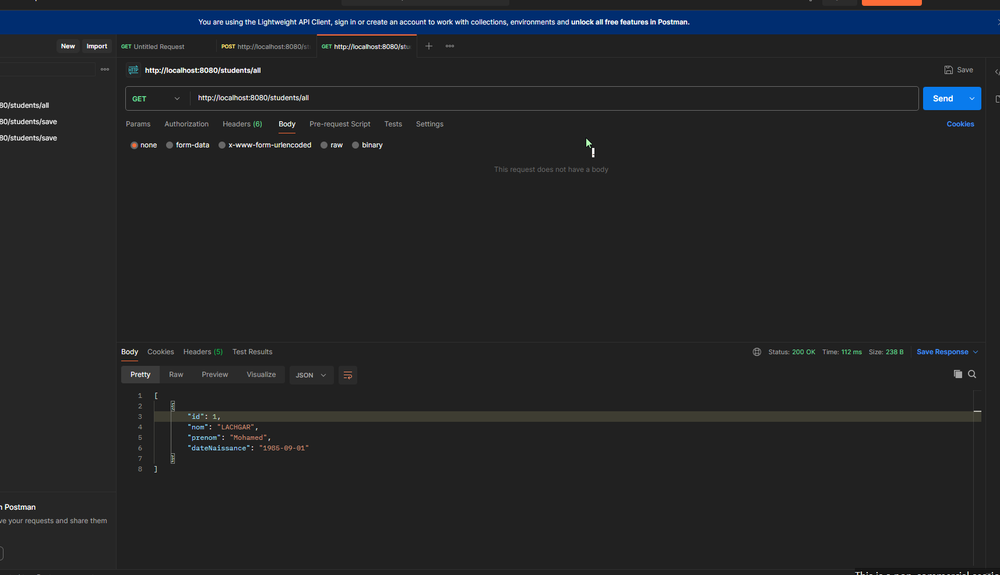

# TP6 : Spring Boot et Swagger

## 1. Tests avec Postman

### Ajout d'un étudiant

Nous avons envoyé `POST /students/save`. La réponse `201 Created` confirme l'ajout de Mohamed LACHGAR avec l'identifiant `1`.

### Liste des étudiants

La requête `GET /students/all` retourne `200 OK` avec les informations de l'étudiant ajouté.

### Nombre d'étudiants

La requête `GET /students/count` retourne `200 OK` et la valeur `1`.

### Nombre d'étudiants par année

La requête `GET /students/byYear` retourne `[[1985, 1]]` : un étudiant est né en 1985.

### Suppression d'un étudiant

Nous avons envoyé `DELETE /students/delete/1`. La réponse `204 No Content` confirme la suppression.

## 2. Test avec Swagger

Nous avons ouvert `http://localhost:8080/swagger-ui.html` et testé `GET /students`, généré par Spring Data REST. La réponse `200` contient une liste vide après la suppression.
